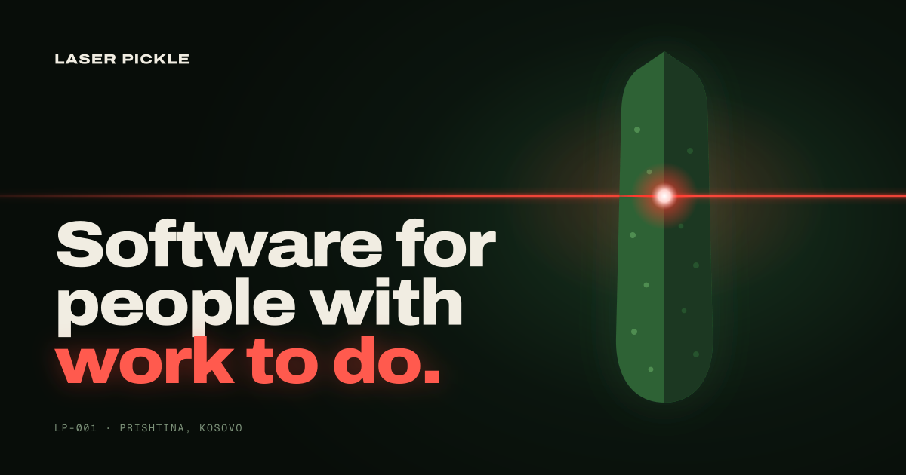

We build focused software products that make everyday work simpler.
Based in Prishtina, Kosovo. And yes, Laser Pickle is the actual company name.

### Products

| Product | What it is | Status |
| --- | --- | --- |
| [Zbuloje](https://zbuloje.com) | Free quizzes for kids by grade and subject, or make your own and share them with a link. No accounts for kids, no tracking of results. | Live |
| [Rritemi](https://rritemi.com) | Software for kindergartens that makes communication between staff and parents, daily updates and everyday administration simpler. | Beta · Preparing launch |
| [Pikëza](https://pikeza.com) | A guide for families in Kosovo: clubs, activities and places for kids, searchable by what is nearest. | Beta · Collecting data |
| Historiku | Software for small garages in Kosovo that keeps every vehicle's service history and reminds customers when the next service is due. | In development |
| Drejto | Software for driving schools to manage candidates, lessons, progress and everyday administration. | In development |
| BugSquat | A planned developer product from Laser Pickle. | Planned |

### Doctrine 01

**Useful beats impressive.** We build focused software around real problems, keep unnecessary complexity out, and care more about whether something works well than whether it looks impressive in a feature list.

[laserpickle.com](https://laserpickle.com) · [hello@laserpickle.com](mailto:hello@laserpickle.com)
